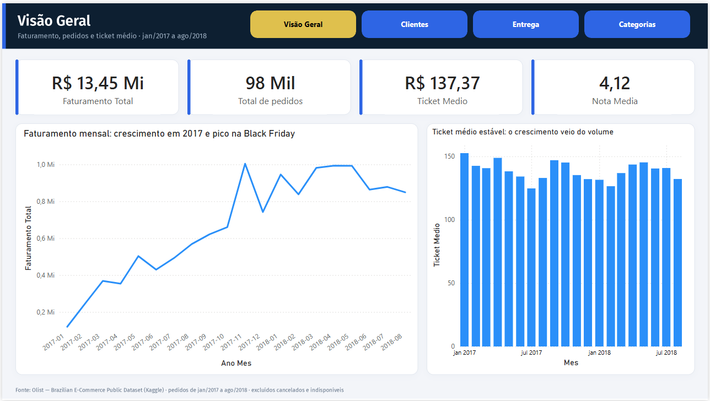
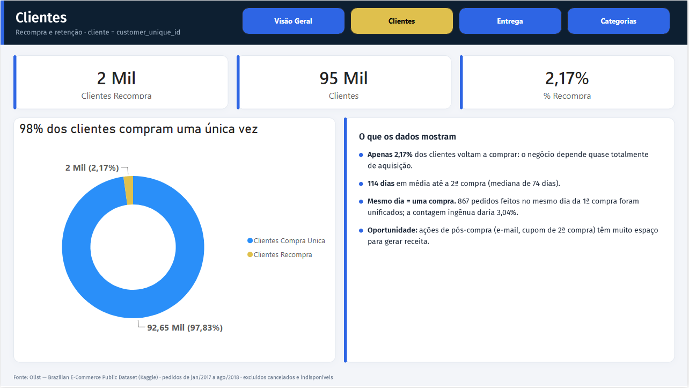
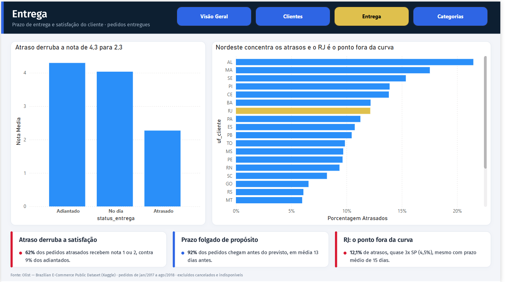
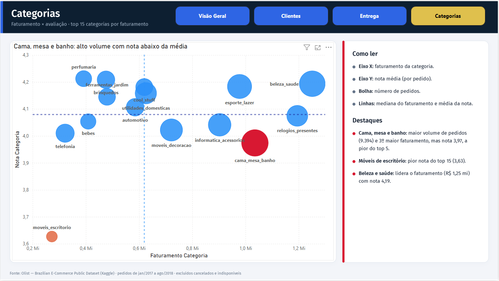

# Análise de E-commerce — Olist

## Contexto

A Olist é um marketplace brasileiro que conecta pequenos lojistas aos grandes canais de venda online. A base pública reúne cerca de 100 mil pedidos feitos entre 2016 e 2018, com informações de clientes, vendedores, produtos, pagamentos, entregas e avaliações.

## Principais achados

**1. O crescimento veio do volume, não do ticket.** O faturamento mensal passou de R$ 120 mil (jan/2017) para um patamar de R$ 850 mil – R$ 1 milhão em 2018, enquanto o ticket médio ficou estável entre R$ 125 e R$ 153. O maior pico da série foi a Black Friday de 2017: novembro faturou 52% a mais que outubro, e só o dia 24/11 teve 1.176 pedidos, cerca de 5 vezes um dia normal.

**2. A retenção de clientes é quase inexistente.** Apenas **2,17%** dos clientes voltam a comprar, e quem volta leva em média 114 dias (mediana de 74). Uma contagem ingênua daria 3,04%, mas 867 "recompras" eram pedidos feitos no mesmo dia da primeira compra, tratados aqui como uma única compra. O negócio depende quase totalmente de aquisição de novos clientes.

**3. O atraso é o principal destruidor de satisfação.**

| Entrega | Pedidos | Nota média | Notas 1 ou 2 |
|---|---|---|---|
| Atrasada | 6.378 | **2,27** | **62,4%** |
| No dia previsto | 1.280 | 4,03 | 12,4% |
| Adiantada | 87.902 | 4,29 | 9,2% |

92% dos pedidos chegam antes do prazo, em média 13 dias antes, o que indica um prazo estimado propositalmente folgado. E o pior cenário nem aparece na tabela: os 1.702 pedidos que ainda não tinham sido entregues têm nota média de **1,82**.

**4. Os atrasos se concentram no Nordeste, com uma exceção no Sudeste.** Alagoas atrasa 21,5% dos pedidos, e os cinco piores estados são nordestinos. O ponto fora da curva é o **Rio de Janeiro**: segundo maior mercado (12 mil pedidos), prazo médio de 15 dias, mas 12,1% de atrasos, quase 3 vezes São Paulo (4,5%). Como a distância não explica a diferença, o problema parece ser logístico local.

**5. Cama, mesa e banho é a categoria de maior risco.** É a categoria com mais pedidos e o 3º maior faturamento (R$ 1,04 milhão), mas tem a pior nota entre as cinco que mais faturam (3,97). Móveis de escritório tem a pior nota do top 15 (3,63). Beleza e saúde lidera o faturamento (R$ 1,25 milhão) com nota alta (4,19).

### Recomendações

- **Retenção:** com 98% de clientes de compra única, ações pós-compra (e-mail, cupom de segunda compra) têm muito espaço para gerar receita.
- **Logística no RJ:** investigar transportadoras e operação local, já que a distância não explica os atrasos.
- **Qualidade em cama, mesa e banho e em móveis:** analisar os comentários das avaliações para separar problemas de produto e de entrega.

## Painel (Power BI)

Quatro páginas com navegação entre elas: visão geral, clientes, entrega e categorias. Arquivo: [`dashboard/olist_dashboard.pbix`](dashboard/olist_dashboard.pbix) · medidas documentadas em [`dashboard/medidas_dax.md`](dashboard/medidas_dax.md).






## Perguntas de negócio

| # | Pergunta | Query |
|---|----------|-------|
| 1 | Como evoluíram o faturamento, o número de pedidos e o ticket médio mês a mês? Existe sazonalidade ou pico pontual? | [`01_evolucao_vendas.sql`](sql/01_evolucao_vendas.sql) |
| 2 | Qual a porcentagem de clientes que compram mais de uma vez, e quanto tempo levam para voltar? | [`02_taxa_recompra.sql`](sql/02_taxa_recompra.sql) |
| 3 | Pedidos entregues com atraso recebem notas piores? Quais estados concentram os atrasos? | [`03_atraso_avaliacao.sql`](sql/03_atraso_avaliacao.sql) · [`03b_atraso_por_estado.sql`](sql/03b_atraso_por_estado.sql) |
| 4 | Quais categorias mais faturam e como se saem em nota média? Há categorias de alto faturamento e nota baixa? | [`04_categorias_faturamento_avaliacao.sql`](sql/04_categorias_faturamento_avaliacao.sql) |

### Definições e recortes

- **Período analisado:** jan/2017 a ago/2018. Os meses de 2016 e de set–out/2018 têm volume residual e distorcem as tendências.
- **Faturamento:** soma do `price` dos itens (sem frete), excluindo pedidos `canceled` e `unavailable`.
- **Ticket médio:** faturamento ÷ número de pedidos.
- **Cliente:** `customer_unique_id`. O `customer_id` é gerado a cada pedido e não identifica a pessoa.
- **Atraso:** data de entrega ao cliente posterior à data estimada; considera apenas pedidos `delivered` com data de entrega preenchida.
- **Recompra:** nova compra do mesmo cliente em outro dia; pedidos feitos no mesmo dia contam como uma única compra.
- **Avaliação:** uma nota por pedido (a avaliação mais recente, quando há mais de uma).

## Dados

Fonte: [Brazilian E-Commerce Public Dataset by Olist (Kaggle)](https://www.kaggle.com/datasets/olistbr/brazilian-ecommerce)

| Tabela | Conteúdo |
|--------|----------|
| `orders` | Pedidos, status e datas (compra, aprovação, envio, entrega) |
| `order_items` | Itens de cada pedido, preço e frete |
| `order_payments` | Forma de pagamento, parcelas e valor |
| `order_reviews` | Nota e comentário da avaliação do cliente |
| `customers` | Cliente, cidade e UF |
| `sellers` | Vendedor, cidade e UF |
| `products` | Categoria e dimensões dos produtos |
| `geolocation` | CEP → latitude/longitude |
| `category_translation` | Tradução das categorias (PT → EN) |

## Estrutura

```
olist-ecommerce-analysis/
├── data/raw/      # CSVs do Kaggle (fora do Git)
├── notebooks/     # exploração e qualidade dos dados
├── sql/           # carga + uma query por pergunta de negócio
└── dashboard/     # .pbix, prints, medidas DAX, tema e fundos do painel
```

## Como reproduzir

Na pasta `olist-ecommerce-analysis/`, com os CSVs já em `data/raw/`:

```bash
pip install -r requirements.txt

# carrega os CSVs no banco local olist.duckdb
python -c "import duckdb; con = duckdb.connect('olist.duckdb'); con.execute(open('sql/00_carga.sql', encoding='utf-8').read()); print(con.fetchall())"
```

Se tiver o [DuckDB CLI](https://duckdb.org/docs/installation/) instalado, também dá para rodar com `duckdb olist.duckdb < sql/00_carga.sql`.

## Ferramentas

SQL (DuckDB) · Python (pandas) · Power BI
