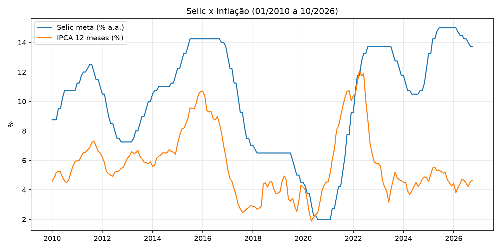
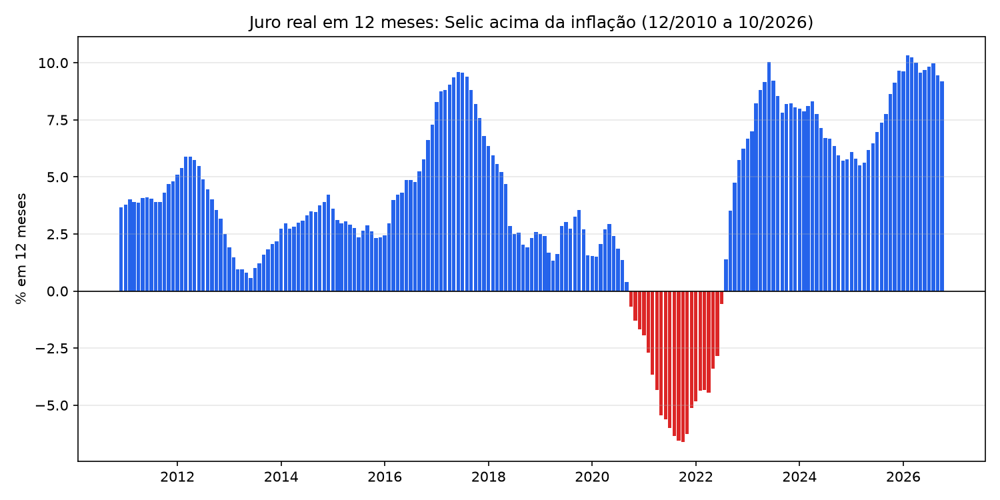
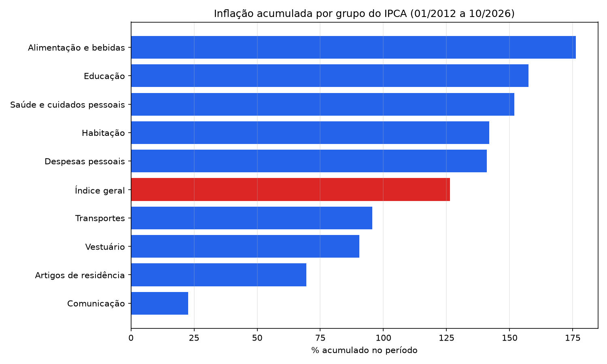
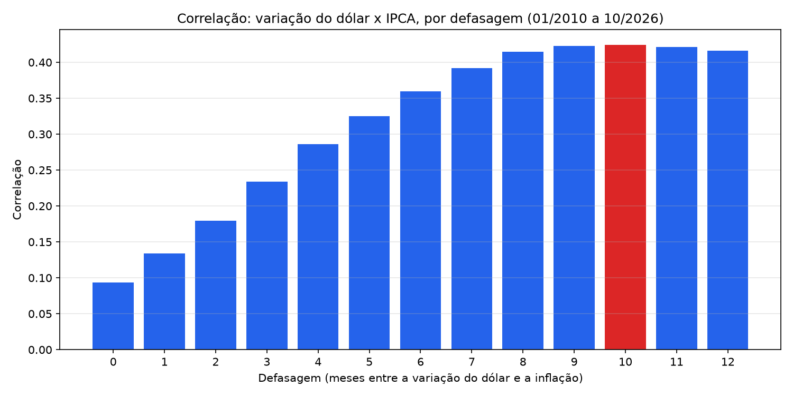

# Inflação, juros e câmbio no Brasil

> ✅ Projeto finalizado

Pipeline em Python que coleta dados das APIs públicas do Banco Central e do IBGE, trata e analisa a relação entre inflação, taxa de juros e câmbio no Brasil.

## Perguntas de negócio

1. O Banco Central reage à inflação? Como a Selic se moveu nos picos de inflação?
2. Quanto rende o juro real, ou seja, a Selic acumulada em 12 meses descontada a inflação do período?
3. Quais grupos do IPCA mais pesaram no bolso?
4. O dólar antecipa a inflação?

## Fontes de dados

- **Banco Central (SGS):** IPCA, Selic e dólar
- **IBGE (API de agregados):** IPCA por grupo de produtos e serviços

## Ferramentas

Python (requests, pandas) · Parquet · matplotlib · GitHub Actions

## Principais achados

**1. O Banco Central reage à inflação, mas com atraso.** Em 2021, a Selic só começou a subir cerca de 8 meses depois da virada da inflação.



**2. O juro real ficou negativo por quase dois anos.** De outubro de 2020 a julho de 2022, a Selic rendeu menos que a inflação, chegando a -6,5% em 12 meses. Em 2026, o juro real passou de 10%, o maior nível desde 2010.



**3. A inflação pesou mais no essencial. De 2012 a 2026, alimentação e bebidas subiram 176%, contra 126% do índice geral.** Educação, saúde e habitação também ficaram acima da média. No outro extremo, comunicação subiu só 23%.

 

**4. O dólar chega à inflação com quase um ano de atraso.** A correlação entre a variação do dólar e o IPCA é quase nula no mesmo mês (0,09) e cresce até cerca de 0,42 com 8 a 12 meses de defasagem. É uma relação moderada: o câmbio ajuda a explicar a inflação futura, mas não sozinho.



## Como funciona o pipeline

```
extrair_bcb.py  ─┐
                 ├──►  data/bruto  ──►  tratar.py  ──►  data/tratado  ──►  analisar.py  ──►  graficos/
extrair_ibge.py ─┘
```

| Etapa | Script | O que faz |
|---|---|---|
| Extração | `src/extrair_bcb.py` | Baixa 5 séries do Banco Central (IPCA mensal e 12 meses, Selic meta e mensal, dólar) desde 2010 |
| Extração | `src/extrair_ibge.py` | Baixa o IPCA mensal do índice geral e dos 9 grupos, desde 2012 |
| Tratamento | `src/tratar.py` | Converte tipos, transforma a Selic diária em mensal, junta as séries e calcula a Selic e o juro real em 12 meses |
| Análise | `src/analisar.py` | Gera os 4 gráficos, com o período atualizado automaticamente nos títulos |

**Atualização automática:** um workflow do GitHub Actions roda o pipeline completo todo dia 15 (depois da divulgação do IPCA pelo IBGE) e salva os dados e os gráficos novos no repositório.

### Como reproduzir

```bash
python -m venv .venv
.venv\Scripts\activate            # no Linux/Mac: source .venv/bin/activate
python -m pip install -r requirements.txt

python src/extrair_bcb.py
python src/extrair_ibge.py
python src/tratar.py
python src/analisar.py
```

## Decisões e armadilhas tratadas

- **Limite de 10 anos da API do Banco Central.** Consultas acima de 10 anos retornam erro, então o extrator divide o período em blocos e junta os resultados.
- **Respostas 304 vindas de cache.** Em redes com proxy, a API respondia "não modificado" sem dados. A solução foi enviar cabeçalhos `no-cache` e um parâmetro que muda a cada chamada.
- **Falhas temporárias do servidor (erro 502).** A série diária da Selic, a mais pesada, falhou no GitHub Actions. O extrator agora tenta de novo até 4 vezes, com espera crescente (5s, 10s, 20s).
- **O IPCA por grupo está dividido em duas tabelas do IBGE**: a 1419 (2012 a 2019) e a 7060 (2020 em diante). As duas são buscadas e empilhadas.
- **Metadados inconsistentes no IBGE.** Na tabela 1419, todas as categorias vêm com `nivel = -1`, então não dá para filtrar os grupos pelo nível. Os 10 códigos foram fixados no código e verificados nas duas tabelas.
- **A Selic meta pelo último dia do mês.** A série é diária; para representar o mês, usa-se a meta vigente no fim dele (`last`). Usar o maior valor (`max`) mostraria a meta antiga nos meses de corte de juros.
- **Só meses completos.** As séries são unidas com `inner join`, então um mês só entra na análise quando todas as séries já foram divulgadas.
- **Juros compostos.** A Selic em 12 meses multiplica os fatores mensais, em vez de somá-los.
- **O juro real pela equação de Fisher**: (1 + Selic) ÷ (1 + IPCA) − 1. A
