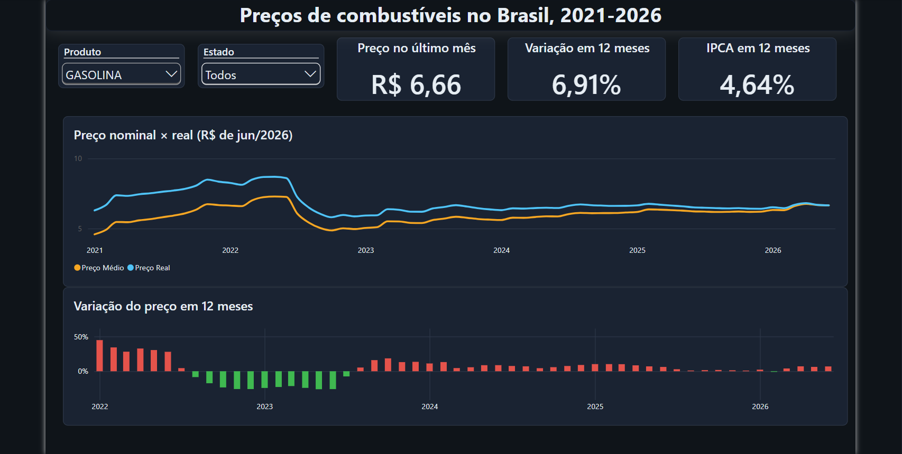
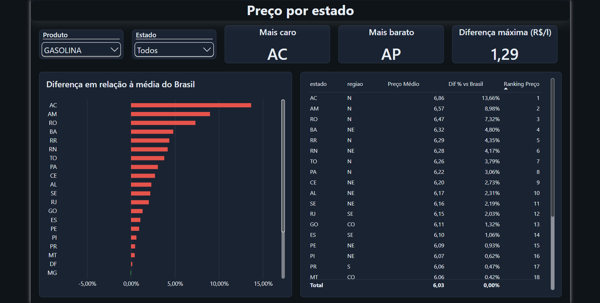
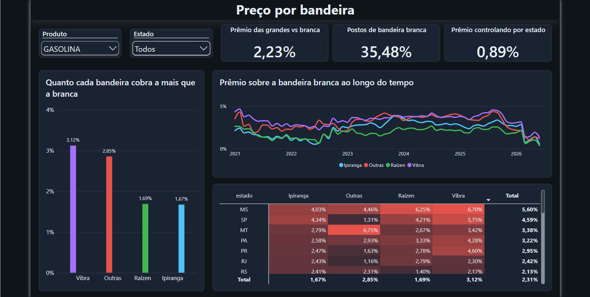
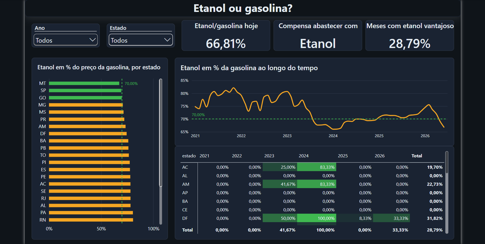

# Preços de combustíveis no Brasil (2021–2026)

Pipeline completo de dados — da extração automática nos dados abertos da ANP até um dashboard em Power BI — para responder perguntas práticas sobre o preço dos combustíveis: quanto subiu de verdade (descontada a inflação), onde é mais caro, se as grandes distribuidoras cobram mais e quando o etanol compensa.



## Perguntas

1. Como o preço evoluiu, em valores **nominais e reais** (descontado o IPCA)?
2. Quais estados são mais caros e mais baratos em relação à média do Brasil?
3. Postos das grandes distribuidoras (Vibra, Ipiranga, Raízen) cobram mais que os de **bandeira branca**?
4. **Etanol ou gasolina?** Em que estados e períodos o etanol ficou abaixo de 70% do preço da gasolina?

## Principais resultados

> Valores da gasolina comum, salvo indicação. Preço real em R$ de junho/2026.

**Evolução (pergunta 1)**
- A gasolina saiu de **R$ 4,59** (jan/2021) para o pico de **R$ 7,29** (mai/2022) e estava em **R$ 6,66** em jun/2026.
- Em 12 meses, subiu **6,9%**, acima do IPCA do período (**4,6%**).
- Corrigido pela inflação (**37,6%** acumulados de jan/2021 a jun/2026), o pico de 2022 equivale a **R$ 8,70** de hoje: o preço atual está cerca de **23% abaixo** daquele pico em termos reais.
- A variação em 12 meses foi de **+30%** (mai/2022) a **−23%** (out/2022) em cinco meses — virada que coincide com o limite ao ICMS sobre combustíveis aprovado em 2022.

**Estados (pergunta 2)**
- O **Acre** é o mais caro (R$ 6,86, **+13,7%** vs. Brasil) e o **Amapá** o mais barato (R$ 5,56, **−7,9%**) no período.
- Os três estados mais caros são do Norte (AC, AM, RO).

**Bandeiras (pergunta 3)**
- Na comparação nacional, as grandes distribuidoras cobram **2,2%** a mais que os postos de bandeira branca (Vibra +3,1%, Ipiranga e Raízen +1,7%).
- **Controlando pelo estado, o prêmio cai para 0,9%.** A maior parte da diferença nacional era efeito de composição geográfica (paradoxo de Simpson), não da bandeira.
- Em parte do Norte e do Nordeste (AM, AC, AL, MA) as grandes são, em média, **mais baratas** que a bandeira branca.
- Postos de bandeira branca respondem por cerca de **35%** das coletas.

**Etanol × gasolina (pergunta 4)**
- Em jun/2026 o etanol custava **66,8%** da gasolina: **compensa** abastecer com etanol.
- Na média de 2021–2026, só **MT, SP e GO** ficaram abaixo de 70% — estados do cinturão da cana.
- Na média nacional, o etanol compensou em **29%** dos meses do período e em **100% dos meses de 2024**.
- No Amapá, em 2021, o etanol chegou a custar **mais** que a gasolina.

## Dashboard

| Página | Conteúdo |
|---|---|
| Visão geral | KPIs do último mês, preço nominal × real, variação em 12 meses |
| Estados | Diferença de cada estado vs. Brasil, ranking, mais caro × mais barato |
| Bandeiras | Prêmio de cada bandeira sobre a branca, evolução no tempo, mapa de calor por estado |
| Etanol × gasolina | Razão etanol/gasolina, limite de 70%, frequência de meses vantajosos por estado e ano |

<p float="left">
  
  
</p>


## Como funciona o pipeline

```
ANP (CSVs/ZIPs semestrais)
   │  src/extrair_anp.py     → data/bruto/      (11 semestres, ~226 MB)
   ▼
Pandas
   │  src/tratar.py          → data/tratado/precos.parquet   (4,74 mi linhas, 33 MB)
   ▼
DuckDB (SQL)
   │  sql/01_exploracao.sql  → validação, outliers, bandeiras
   │  sql/02_modelo.sql      → modelo estrela + índice IPCA
   │  sql/03_export_powerbi.sql → data/powerbi/   (~400 KB)
   ▼
Power BI (DAX)               → dashboard/
```

**Modelo estrela**

| Tabela | Linhas | Papel |
|---|---|---|
| `fato_precos_mensal` | 45.657 | Mês × estado × produto × grupo de bandeira, com **soma** e **contagem** |
| `dim_estado` | 27 | Estado e região |
| `dim_produto` | 6 | Produto, unidade e flag de produto principal |
| `ipca` | 70 | IPCA mensal e índice acumulado (reaproveitado do [projeto 2](../inflacao-juros-cambio-brasil)) |
| `Calendario` | — | Criada em DAX, marcada como tabela de datas |

**Medidas DAX de destaque**: preço médio ponderado com proteção contra mistura de produtos (`HASONEVALUE`), preço real com iterador (`SUMX` + transição de contexto), inteligência de tempo (`SAMEPERIODLASTYEAR`), comparação com o Brasil (`REMOVEFILTERS`), ranking (`RANKX`), controle por estado (`AVERAGEX`) e frequência de meses (`FILTER` + `COUNTROWS`).

## Decisões e armadilhas tratadas

**Na extração (dados da ANP)**
- **Mudança de formato**: até o 1º semestre de 2022 os arquivos são `.csv`; depois, `.zip`. O extrator tenta os dois formatos.
- **Nome fora do padrão**: o 1º semestre de 2022 foi publicado como `precos-semestrais-ca.zip`. A exceção fica documentada num dicionário `EXCECOES` e o arquivo é salvo com o nome padrão.
- **Idempotência**: arquivos já baixados são pulados; semestres ainda não publicados (404) não quebram o script.

**No tratamento**
- **Encoding misto**: só o 2º semestre de 2021 está em latin-1. O script tenta UTF-8 primeiro e cai para latin-1 — nessa ordem, porque latin-1 nunca falha e corromperia acentos de arquivos UTF-8.
- **Linhas vazias**: ~9 mil linhas totalmente vazias no 1º semestre de 2025, removidas após confirmar que não havia linhas parcialmente preenchidas.
- **CNPJ com tipo inconsistente**: em alguns anos vem formatado (texto), em outros só com dígitos (número, perdendo zeros à esquerda). Lido sempre como texto e padronizado em 14 dígitos.
- **Unidade do GNV**: `R$ / m³` em todos os semestres, exceto no 2º semestre de 2025 (`R$ / m3`), o que duplicava o produto na dimensão.
- **Coluna descartada**: `Valor de Compra` está vazia desde 2020.
- **Memória**: só as colunas necessárias são lidas e as categóricas viram `category` (750 MB → 380 MB em memória).

**Na análise**
- **Outliers**: comparar cada preço com a mediana do período inteiro marcava ~3,3 mil "suspeitos" — na verdade, preços legítimos de 2021, antes da alta do diesel. Comparando com a mediana **do mesmo produto no mesmo mês**, restaram 17 casos em 4,7 milhões, mantidos.
- **Bandeiras com vários nomes**: a Vibra aparece como `VIBRA`, `VIBRA ENERGIA` e `PETROBRAS DISTRIBUIDORA S.A.`; a Raízen como `RAIZEN` e `RAIZEN MIME`. Agrupadas em `grupo_bandeira`.
- **Média de médias**: a fato guarda soma e contagem (medidas aditivas), e o DAX calcula a média ponderada correta em qualquer filtro.
- **Unidades e produtos misturados**: o preço médio só é calculado quando há um único produto no contexto, evitando totais sem sentido (litro com m³, gasolina com etanol).
- **Vazio tratado como zero**: em subtrações, o DAX trata vazio como zero, gerando −100% em meses ou estados sem dados. As medidas de diferença verificam se os dois lados existem.
- **Ranking por região**: `ALL(dim_estado[estado])` mantinha o filtro de região quando a coluna estava no visual; `ALL(dim_estado)` corrige.
- **Efeito de composição**: o prêmio das grandes bandeiras é calculado também dentro de cada estado (`AVERAGEX`). Ressalva: essa média dá o mesmo peso a todos os estados.

## Como reproduzir

```bash
cd precos-combustiveis-brasil
python -m venv .venv
.venv\Scripts\activate          # Windows (CMD)
pip install -r requirements.txt

python src/extrair_anp.py       # baixa os semestres da ANP
python src/tratar.py            # gera data/tratado/precos.parquet

duckdb combustiveis.duckdb
.read sql/01_exploracao.sql
.read sql/02_modelo.sql
.read sql/03_export_powerbi.sql
```

Depois, abra `dashboard/Precos_combustiveis_brasil_2021_2026.pbix` e atualize os dados.

## Estrutura

```
precos-combustiveis-brasil/
├── src/
│   ├── extrair_anp.py
│   └── tratar.py
├── sql/
│   ├── 01_exploracao.sql
│   ├── 02_modelo.sql
│   └── 03_export_powerbi.sql
├── data/
│   ├── bruto/        (ignorado no Git)
│   ├── tratado/      (ignorado no Git)
│   └── powerbi/      (modelo exportado)
├── dashboard/
│   ├── Precos_combustiveis_brasil_2021_2026.pbix
│   ├── tema_combustiveis_dark.json
│   └── prints/
└── requirements.txt
```

## Ferramentas

| Ferramenta | Uso |
|---|---|
| **Python** (`requests`, `pandas`, `pyarrow`) | Extração e tratamento |
| **DuckDB** (SQL) | Exploração, modelagem e exportação |
| **Power BI** (DAX) | Modelo estrela, medidas e dashboard |
| **Git / GitHub** | Versionamento |
| **Claude** (Anthropic) | Mentor ao longo do projeto: sugeriu etapas, revisou o código e apontou armadilhas. O código, as consultas e as medidas foram escritos por mim. |

## Fonte

Agência Nacional do Petróleo, Gás Natural e Biocombustíveis (ANP) — *Série Histórica de Preços de Combustíveis* (Levantamento de Preços de Combustíveis), dados abertos. IPCA: Banco Central do Brasil (SGS, série 433), via projeto 2.

## Próximos passos

- Dispersão de preços dentro de cada cidade (quanto se economiza escolhendo o posto).
- Novas tentativas com espera crescente no extrator, para instabilidades do servidor da ANP.
- Automação semestral com GitHub Actions, como no projeto 2.
- Prêmio das bandeiras ponderado pelo número de coletas de cada estado.
